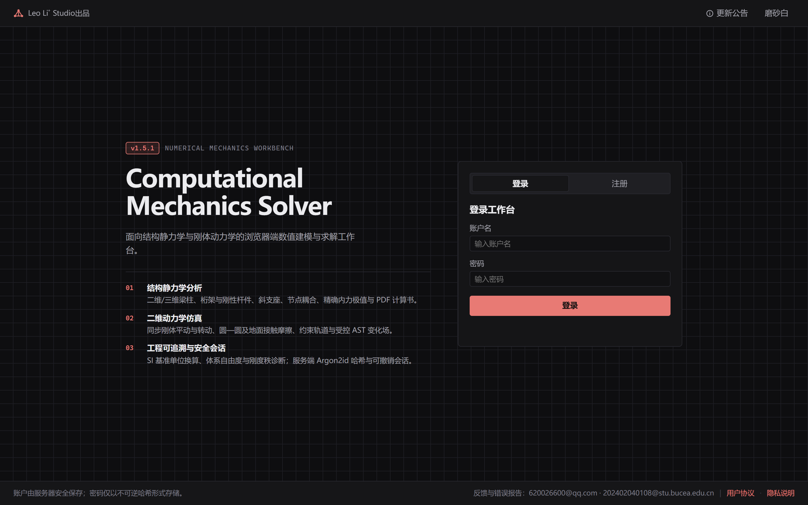
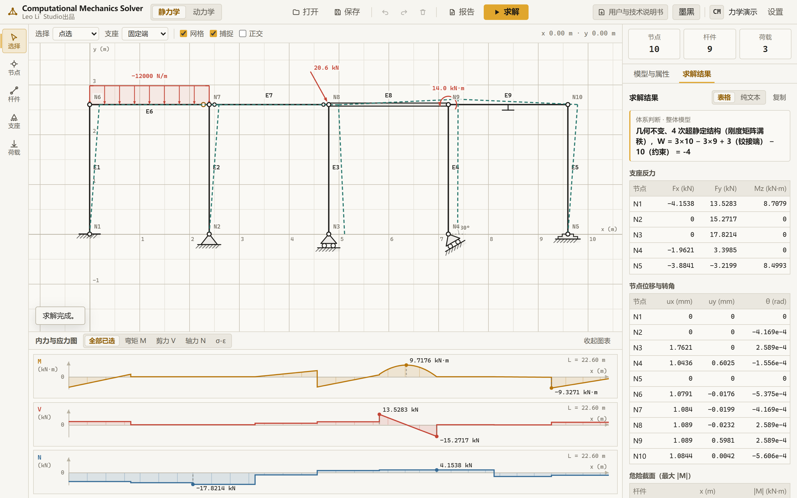
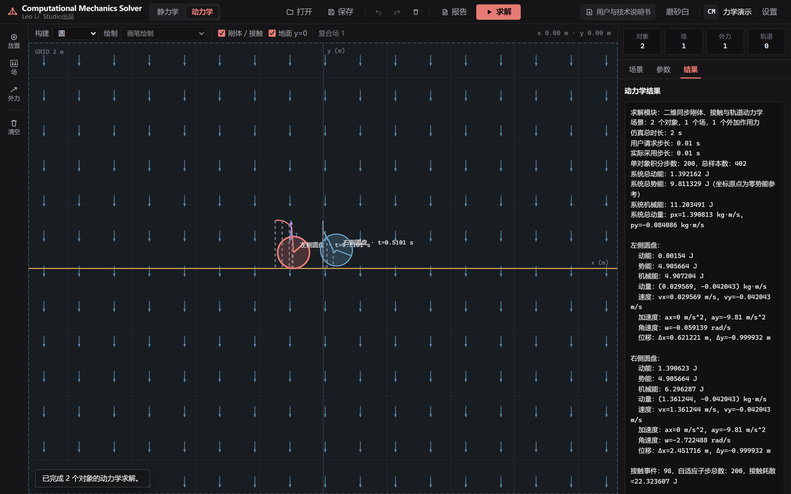
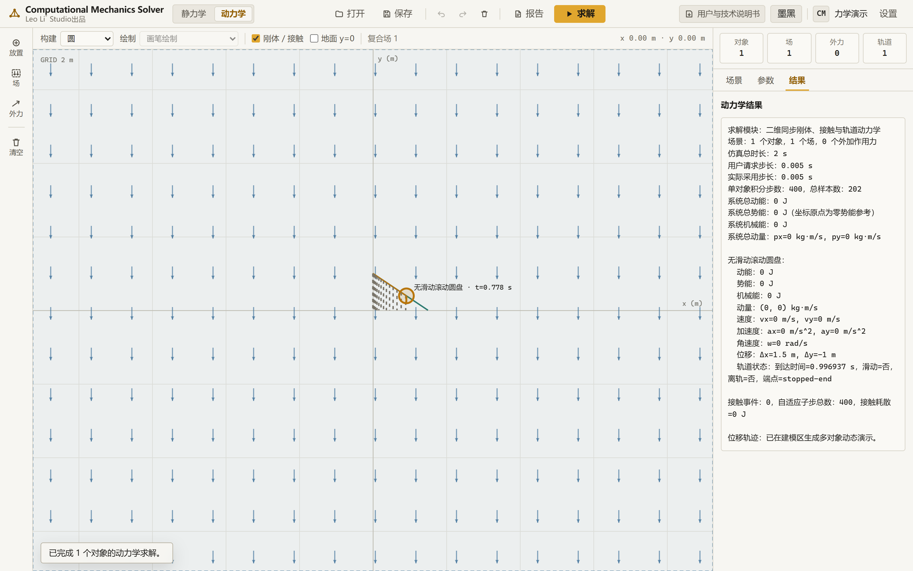
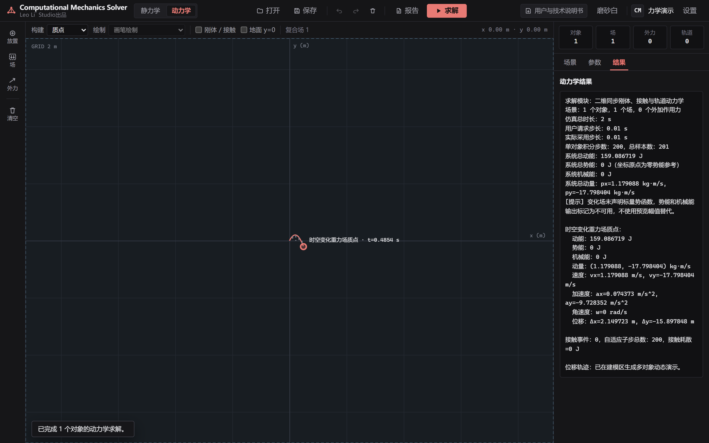

# 阅读本手册

Computational Mechanics Solver v1.5.1 是一个面向力学学习、教学演示和原型验证的二维计算工作台。它将图形建模、国际单位制换算、结构静力学求解、二维同步刚体与轨道动力学仿真、高分辨率结果图形与 PDF 计算书连接为统一的工作流。本手册从首次打开软件开始，详细说明建模步骤、控制方程、实机验证案例以及当前版本的能力边界。

> **安全提示：** 本软件不是经过工程认证的设计软件。任何与建筑、机械、交通、能源或人身安全有关的结论，都必须由具备相应资质的专业人员使用独立方法复核。不要只凭一张内力图、一个极值或一份自动报告作出工程安全决定。

## 适合哪些读者

- 第一次接触结构力学与刚体动力学数值软件的本科生。
- 需要演示矩阵位移法、梁柱内力、刚体碰撞、无滑动滚动或时空变化场的教师。
- 希望将理论解析解与数值积分结果进行定量对照的课程学习者。
- 需要快速搭建二维力学原型并导出结构化计算书的普通用户。

## 软件可以完成什么

:::table id=capability-summary title=v1.5.1 主要能力总览
| 模块 | 当前可用能力 | 读取结果时的重点 |
|---|---|---|
| 静力学 | 二维梁柱、平面桁架、高刚度近似杆、弧形/直角/任意路径弧长离散、斜向滚动支座、单端弯矩释放、节点与杆中集中荷载、分布荷载与均布力偶、隔离体结果视图 | 体系判断、整体力与力矩平衡、节点位移与转角、斜支座法向/切向反力、N/V/M 图极值与危险截面 |
| 动力学 | 独立质点与二维同步刚体世界（平动+转动）、圆—圆与圆—地面接触摩擦、直线/斜坡/折线/圆弧/Bezier 轨道滑动与无滑动滚动、受控 AST 时空变化场、偏心持续力与冲量 | 终态速度与角速度、动能/势能/机械能、接触事件与耗散、轨道到达时间与离轨状态、步长收敛性 |
| 界面与工程 | 浅红·墨黑与磨砂白·暖黄双极简主题、HiDPI 视网膜画布、结构化结果表格、服务器账户安全会话、工程文件保存/打开与 PDF 计算书导出 | 确认单位制与工程版本，所有账户拥有完全一致的求解与报告能力 |

## 当前不能解决什么

- 材料屈服、塑性、开裂、疲劳、断裂、屈曲和几何大变形。
- 工程规范校核、荷载组合、抗震设计和承载力认证。
- 弹性地基、同一单元双端弯矩释放、轴向/剪切释放与通用半刚接。
- 轨道对象与自由/接触对象进入同一碰撞世界；离轨或到达开放端点后继续自由飞行。
- 非圆多边形任意刚体之间的通用碰撞（当前碰撞仅支持圆与显式正碰撞半径质点）。
- 未声明标量势函数的变化场自动推导势能或机械能结论。
- 界面中标注“开发中”的 PINN 求解器与函数曲线绘制，在 v1.5.1 中保持禁用，不能作为计算依据。

# 第一次使用

## 浏览器与显示要求

建议使用当前稳定版 Microsoft Edge 或 Google Chrome。桌面端工作台针对常见笔记本（1280×720 及以上）与高分辨率显示器（1440×900 及以上）采用全视口锁定布局与 HiDPI 画布缩放，支持清晰的细线工程图元渲染；移动端与窄屏设备会自动折叠为纵向可滚动布局。浏览器应允许下载工程 JSON 文件与 PDF 计算书。

## 账户注册、登录与会话安全

v1.5.1 采用服务器端账户管理。密码仅以不可逆哈希形式保存，登录会话通过受保护的 HttpOnly Cookie 维持，支持退出与修改密码时自动撤销会话。v1.5.1 起移除了所有套餐、权益门控与内部测试通道，所有注册用户拥有完全相同的求解与报告能力。

1. 打开首页，点击右侧认证卡片中的“注册”标签。
2. 输入账户名、不少于 10 位的密码、确认密码及昵称，勾选同意《用户协议》与《隐私说明》。
3. 可选择上传个人头像，或保留默认的字母头像。
4. 注册或登录成功后，界面直接显示“静力学”与“动力学”双模块入口卡片，无需多余确认步骤。
5. 进入任意工作台后，点击右上角“设置”可调整界面字号、修改昵称、更新头像、修改密码或退出登录。

首页欢迎界面与认证工作台见图 {{fig:welcome-v151}}。

{#welcome-v151 width=154mm}

## 统一顶栏与双极简主题

静力学与动力学共享完全一致的 44 px 单行顶栏、52 px 左侧线性图标工具栏、34 px 上下文工具条（含实时世界坐标读数）和 316 px 标签页右侧检查器，在两个模块间切换不会产生界面跳动。

点击顶栏的“磨砂白 / 墨黑”按钮可在两套理工极简配色间即时切换，偏好会自动保存于当前浏览器：

- **浅红 · 墨黑（默认暗色）**：低眩光深墨黑画布搭配浅红高亮与柔和物理数据色，适合长时间建模与高对比度曲线阅读。
- **磨砂白 · 暖黄（亮色）**：暖灰纸面基底搭配暖黄主色与深炭黑文字，适合日间演示与图纸对照。

# 通用建模操作

## 无限画布、缩放与平移

画布代表连续可扩展的二维世界坐标平面，默认开启双级坐标网格与原点轴线。滚动鼠标滚轮以指针为中心平滑缩放；在选择工具下按住画布空白处拖动即可平移视口。缩放与平移仅改变观察窗口，不改变节点或对象的真实世界坐标。上下文工具条右侧实时显示当前指针的世界坐标。

## 网格、捕捉、正交与快捷键

- **网格**：控制画布双级辅助网格的显示或隐藏。
- **捕捉**：使新放置的节点自动吸附到网格交点或邻近已有节点。
- **正交**：在绘制直杆时将方向约束为水平或竖直。
- **快捷键**：在静力学工作台（无弹窗且未聚焦输入框时），按 `V`、`N`、`E`、`S`、`L` 可快速切换选择、节点、杆件、支座与荷载工具；`Ctrl+Z` / `Ctrl+Y` 用于撤销与重做；`Delete` 删除当前选中对象；`Esc` 取消当前场放置草稿或关闭公告弹窗。

## 撤销、重做、保存与打开

撤销与重做按完整编辑动作记录模型快照，最多保留 100 步历史。点击顶栏“保存”可导出标准工程 JSON 文件，“打开”可重新导入。建议在几何建模完成、荷载检查完成、求解核对完成后分别保存独立版本。

## 单位规则

界面支持常见工程单位输入，求解前统一换算至国际单位制（SI）。输入数值时应同时写明单位，避免数量级误读。

:::table id=unit-guide title=常用输入与核心计算单位
| 物理量 | 常用输入 | 核心计算单位 |
|---|---|---|
| 长度、位移 | mm、m | m |
| 力 | N、kN | N |
| 力矩、力偶 | N·m、kN·m | N·m |
| 分布荷载 | N/m、kN/m | N/m |
| 均布力偶 | N·m/m、kN·m/m | N·m/m |
| 弹性模量、应力 | MPa、GPa | Pa |
| 面积、惯性矩 | mm²、mm⁴、m²、m⁴ | m²、m⁴ |
| 时间、速度、加速度 | s、m/s、m/s² | s、m/s、m/s² |
| 角度、角速度 | °、rad、rad/s | rad、rad/s |
| 电场、磁场 | N/C、T | N/C、T |

# 静力学建模

## 节点与自由度

每个二维静力学节点包含水平位移、竖直位移与平面转角三个自由度：

:::equation id=node-dofs text=u_i=(u_x,u_y,theta_z)^T

建立杆件前先放置节点，或使用杆件工具依次点击起点与终点。节点在屏幕上看似重合但未复用同一节点编号时，结构在刚度矩阵中实际处于断开状态，应使用捕捉功能或查看模型诊断中的连通分量确认。

## 普通梁柱、平面桁架与高刚度近似杆

- **普通梁柱（frame）**：按小位移、线弹性 Euler-Bernoulli 梁理论建立单元刚度矩阵，同时传递轴力、剪力和弯矩，核心参数为弹性模量 E、截面面积 A 和截面惯性矩 I。
- **平面桁架杆（truss）**：仅传递轴力，画布上在杆件两端以空心铰圆清晰标识，其轴向刚度为：

:::equation id=truss-stiffness text=k_a=EA/L

桁架杆仅可在节点处承受外荷载，不能直接施加杆中横向集中力、分布荷载或均布力偶。

- **高刚度近似杆（rigid）**：在画布上以对称平行双轨标识，通过放大普通梁柱刚度近似刚性连接。由于属于高刚度数值近似而非精确刚体约束方程，使用后应检查刚度矩阵条件数并对关键结果作复核。

## 曲线、直角、任意路径离散与 T 形杆件

在杆件设置弹窗中选择不同几何形状时，弹窗会按几何类型自动显示对应参数（如弧形曲率/弧度或 T 形高度）：

- **弧形、直角与任意形状杆件**：v1.5.1 求解器会沿真实绘制路径将其自动离散为多段直梁柱单元，并把杆中集中荷载与分布荷载按**弧长比例**映射到各子段；求解完成后再按弧长合并回母杆件的内力图与杆端力。
- **T 形杆件**：不进行路径拆分，按两端节点之间的一根直梁柱求解，并在画布中部绘制简洁的 T 形截面标记。

# 支座、连接与荷载

## 固定端、铰支座、滚动支座、倾斜支座与地基

:::table id=support-guide title=v1.5.1 支座类型、图元与真实约束
| 支座类型 | 画布工程图元 | 求解约束 | 允许运动 |
|---|---|---|---|
| 固定端（fixed） | 底板与 45° 斜影地基线 | 约束 ux、uy、rz | 禁止一切平移与转动 |
| 铰支座（pin） | 等腰三角形、空心顶铰与 45° 地基线 | 约束 ux、uy | 允许绕节点自由转动 |
| 滚动支座（roller） | 等腰三角形、双相切滚轮与 45° 地基线 | 约束垂直于地面的法向位移 | 允许沿地面切向滑动与转动 |
| 倾斜滚动支座 | 旋转支座图元 + 水平虚线参考与角度弧标注 | 按支座转角旋转局部约束方向 | 仅沿倾斜地面切向自由滑动 |
| 地基（ground） | 阶梯型扩展基础块与 45° 地基线 | 约束 ux、uy、rz（刚性支承） | 与固定端同为刚性约束，非弹性地基 |

双击任意支座节点或在选择模式下按住 `Alt` 拖动支座图元，即可设定**支座转角**（逆时针为正，0° 表示地面位于节点下方）。在 v1.5.1 中，滚动支座的角度真实参与刚度方程求解：求解结果不仅给出全局反力 Fx、Fy，还会同时分解出垂直于地面的法向反力 R⊥ 与沿地面方向的切向分量 R∥（理想滚动支座应满足 R∥≈0）。

## 节点固化与单端弯矩释放

- **节点固化**：双击普通节点或支座节点可将非游离节点固化为杆件内部点，隐藏节点圆圈但保留拓扑连接关系。
- **单端弯矩释放**：选中普通梁柱后，可在右侧“模型与属性”标签中勾选“i 端铰接”或“j 端铰接”。释放端在画布上显示为空心铰环，该端弯矩强制为零但仍传递轴力与剪力。当前版本单根单元一次仅支持一端弯矩释放。

## 集中荷载、集中力偶、分布荷载与均布力偶

- **节点与杆中集中力**：支持按方向预设或自定义角度输入，画布箭头停于节点外缘并以等宽标签标明大小。
- **集中力偶**：以带切向箭头的 220° 圆弧清晰表达正负转向（逆时针为正）及量值。
- **分布荷载**：支持均布、线性（三角形/梯形）及多项式分布，沿杆件真实路径全长按线密度施加，总力等于线密度对路径弧长的积分；画布采用自适应箭距、半透明包络填充并自动避让杆件编号。
- **均布力偶**：支持沿普通梁柱全长施加常量分布力偶（单位 N·m/m）。

# 静力学求解与结果

## 模型诊断与矩阵位移法

求解前系统自动执行模型诊断，输出节点数、单元数、约束自由度数、自由自由度数与连通分量，并提示几何构造及公式适用性信息。线性静力学核心求解总体刚度方程：

:::equation id=static-equilibrium text=K u=P

消去受约束自由度得到节点位移后，由总体平衡恢复支座反力：

:::equation id=reaction-recovery text=R=K u-P

若刚度矩阵奇异，通常说明结构存在机构、约束不足、未连接节点或零长度杆件。

## 内力符号约定、结构化结果表与内力图抽屉

静力学内力图的统一符号约定为：
- **轴力 N**：以受拉为正，受压为负。
- **弯矩 M**：以杆件下侧（局部 -y 侧）受拉为正。
- **剪力 V**：取截面左侧横向力之和为正。

求解完成后，界面自动切换至右侧“求解结果”标签并展开底部的**内力与应力图抽屉**：

- **结构化结果表格**：默认展示体系判断卡片，以及右对齐等宽字体的支座反力、节点位移与转角、危险截面（最大 |M|）数据表；支持一键切换“纯文本”查看完整推导与杆端力，或点击“复制”快速导出文本。
- **内力图抽屉**：支持在“全部已选 / 弯矩 M / 剪力 V / 轴力 N / σ-ε”标签间即时切换，采用半透明面积填充、零轴刻线与防裁切极值标注，并可随时折叠以最大化建模视野。
- **隔离体视图**：在求解弹窗中可选择“选中隔离体”，模型仍按整体求解，结果表格与内力图则聚焦于所选杆件及切口杆端内力。

## 结果平衡核对清单

1. 核对全部外荷载与支座反力的水平合力之和 ΣFx=0、竖向合力之和 ΣFy=0。
2. 对任意参考点核对全部外力矩与反力矩之和 ΣM=0。
3. 核对倾斜滚动支座沿滑动面方向的切向反力 R∥ 是否趋近于零。
4. 核对单端弯矩释放端与桁架杆两端的弯矩是否为零。
5. 用解析公式或独立软件交叉复核关键截面的位移与内力极值。

# 静力学案例

## 教学案例：悬臂梁端部集中力

### 案例目标与已知条件

本案例验证固定端 Euler-Bernoulli 梁的位移、转角、反力与内力图精度。梁长 L=2 m，A 端固定，B 端作用竖直向下集中力 P=10 kN。

:::table id=cantilever-input title=悬臂梁输入参数
| 参数 | 数值 | 单位 |
|---|---|---|
| 梁长 L | 2 | m |
| 弹性模量 E | 200 | GPa |
| 截面面积 A | 10000 | mm² |
| 惯性矩 I | 80000000 | mm⁴ |
| 端部集中力 P | 10 | kN |

### 理论解与软件结果对照

自由端竖向位移与转角的精确解析解为：

:::equation id=cantilever-deflection text=u_y(B)=-(P L^3)/(3 E I)

:::equation id=cantilever-rotation text=theta_z(B)=-(P L^2)/(2 E I)

:::table id=cantilever-result title=悬臂梁程序结果与解析对照
| 物理量 | 软件计算值 | 解析理论值 |
|---|---|---|
| B 点竖向位移 uy | -1.6666667 mm | -1.6666667 mm（式 {{eq:cantilever-deflection}}） |
| B 点转角 θz | -1.25×10⁻³ rad | -1.25×10⁻³ rad（式 {{eq:cantilever-rotation}}） |
| A 点竖向反力 Fy | 10.000 kN | 10.000 kN |
| A 点反力矩 Mz | 20.000 kN·m | 20.000 kN·m（等于 PL） |
| 最大剪力 / 弯矩 | 10.000 kN / 20.000 kN·m | 全梁常剪力，固定端最大弯矩 |

## v1.5.1 实测综合案例：含斜支座、端铰与混合杆件的多跨平面刚架

### 案例目标与模型配置

本案例在 v1.5.1 静力学工作台中实际建立并完整求解，集中检验五类支座图元、四种杆件类型与三类荷载在同一超静定结构中的协同求解能力。结构为四跨门式刚架，跨距均为 2.4 m，柱高 2.6 m，材料统一为 E=200 GPa，截面 A=10000 mm²、I=80000000 mm⁴。

:::table id=static-portal-input title=多跨平面刚架关键配置
| 构件 / 节点 | 类型与参数 | 物理验证要点 |
|---|---|---|
| 支座 N1 / N2 / N3 | 固定端 / 铰支座 / 水平滚支座 | 对比三种基础约束反力分量 |
| 支座 N4 | 30° 倾斜滚动支座（逆时针为正） | 验证斜向法向反力与沿面切向零反力 |
| 支座 N5 | 阶梯型刚性地基（ground） | 固定端刚性支承与独立扩展基础图元 |
| 顶梁 E6（N6→N7） | 普通梁柱 + j 端弯矩释放 + 均布荷载 -12 kN/m | 验证 j 端 Mj=0 与跨中正弯矩极值 |
| 顶梁 E7（N7→N8） | 平面桁架杆（truss） | 验证两端弯矩与剪力为零、纯轴力传递 |
| 顶梁 E8（N8→N9） | 高刚度近似杆（rigid） | 验证对称双轨图元与近似刚性传递 |
| 顶梁 E9（N9→N10） | T 形梁柱（teeDepth=0.35 m） | 验证直梁求解与端弯矩传递 |
| 节点荷载 N8 / N9 | N8：(10 kN, -18 kN)；N9：集中力偶 +14 kN·m | 验证斜向集中力与逆时针力偶箭头标注 |

实机求解后的亮色（磨砂白·暖黄）工作台视图、支座工程图元、变形轮廓、M/V/N 内力图抽屉与右侧结构化结果表见图 {{fig:static-portal-v151}}。

{#static-portal-v151 width=156mm}

### 实测求解结果与静力平衡核对

求解器判定该体系为**几何不变、4 次超静定结构**（刚度矩阵满秩，W = 3×10 − 3×9 + 3 − 10 = -4）。实测支座反力与关键内力极值见表 {{table:static-portal-result}}。

:::table id=static-portal-result title=多跨平面刚架实测支座反力与平衡检查
| 支座节点 | Fx (kN) | Fy (kN) | Mz (kN·m) | 专项验证 |
|---|---|---|---|---|
| N1（固定端） | -4.1538 | 13.5283 | 8.7079 | 三分量约束反力完整 |
| N2（铰支座） | 0.0000 | 15.2717 | 0.0000 | 铰支座零弯矩 |
| N3（水平滚支座） | 0.0000 | 17.8214 | 0.0000 | 水平方向自由，Fx=0 |
| N4（30° 斜滚支座） | -1.9621 | 3.3985 | 0.0000 | 法向 R⊥=3.9242 kN，沿面 R∥=3.40×10⁻¹⁰ kN≈0 |
| N5（地基） | -3.8841 | -3.2199 | 8.4993 | 右端拉拔约束反力 |
| **支座反力总和** | **-10.0000** | **+46.8000** | — | **与外荷载 (+10.0, -46.8) kN 精确平衡** |

进一步核查杆端内力可知：E6 的 j 端释放铰处 Mj = 0 kN·m；桁架杆 E7 剪力与弯矩均为 0，仅承受轴力 4.1538 kN；全结构最大弯矩极值位于 E6 跨内 x=1.1274 m 处（9.7176 kN·m），最小弯矩位于 E9 左端（-9.3271 kN·m），最大压轴力位于柱 E3（-17.8214 kN）。各项力学约束与整体静力平衡均精确满足。

# 动力学建模

## 独立质点模式与二维同步刚体世界

v1.5.1 动力学模块支持两种物理模型并按场景自动切换：

- **独立质点模式**：当场景仅包含普通非刚体对象且无接触、无轨道、无变化场时，各对象沿各自状态方程独立积分。
- **二维同步刚体世界**：当勾选“刚体 / 接触”、启用“地面 y=0”、配置表达式变化场或打开包含轨道约束的 v2 工程时，求解器自动进入同步二维物理世界，实时积分平动与转动六维状态：

:::equation id=rigid-body-state text=Y=(x,y,v_x,v_y,theta,omega)^T

其中 θ 为逆时针正转角，ω 为角速度。实心圆盘、圆环、细杆与矩形均按对应几何自动计算质心转动惯量 I。

## 对象放置与场景管理

在上下文工具条中选择构建形状（质点、杆、圆、圆环、矩形或画笔绘制任意形状），点击左侧“放置”工具后在画布指定位置单击即可放置对象。右侧检查器通过“场景 / 参数 / 结果”三标签清晰分区：顶部 4 列指标卡实时统计对象、场、外力与轨道数量；点击场景列表项可切换选中对象或重新编辑环境场。

# 环境场与外加作用力

## 重力场、电场与垂直磁场

- **重力场**：由加速度大小与方向角确定，产生 m g 作用力。
- **电场**：对带电对象产生 q E 作用力。
- **二维垂直磁场**：垂直于画布平面的 Bz（点场向外、叉场向内），产生洛伦兹力：

:::equation id=lorentz-force text=F=q(E+v cross B)

## 全局、有限范围与受控 AST 变化场

环境场可设为全局作用，也可限定在矩形、圆形或鼠标手绘闭合多边形范围内，并支持多个不同范围的场叠加。在 v1.5.1 中，重力场、电场和磁场均支持四种变化模式：**常量**、**时间 t**、**空间 x, y** 以及**时间—空间 t, x, y, vx, vy**。

> **表达式安全机制：** 变化场表达式采用受控抽象语法树（AST）解析与白名单数学函数求值，仅允许使用 t、x、y、vx、vy 及标准数学函数（如 sin、cos、exp、sqrt、abs 等），绝不执行工程文件中的脚本代码。

## 外加持续力、冲量与偏心作用点

点击左侧“外力”工具可向指定对象施加持续力（含开始时间与持续时间）或瞬时冲量。v1.5.1 新增作用点参考系选择，支持**质心**、**局部偏移坐标**与**世界坐标**。当外力或冲量不通过质心时，求解器按力臂 r 计算真实力矩与角冲量：

:::equation id=eccentric-torque text=tau=r_x F_y-r_y F_x

从而同时改变刚体的质心平动速度与自转角速度。

# 动力学求解与结果

## 四阶 Runge-Kutta 积分与自适应接触子步

无接触自由运动与平滑变化场采用经典四阶 Runge-Kutta（RK4）积分：

:::equation id=rk4-update text=Y_(n+1)=Y_n+h(k_1+2k_2+2k_3+k_4)/6

在包含接触碰撞的同步刚体世界中，求解器会根据相对速度与强外部加速度自动细分接触子步（adaptive substeps）以防止高速穿透；当子步数超出安全上限时会主动停止并给出明确提示。

## 物理量输出、轨迹动画与收敛检查

点击顶栏“求解”可自由勾选动能、势能、机械能、动量、轨道角动量、洛伦兹力、速度、加速度、角速度、角加速度、力矩、质心转动惯量、位移、位移轨迹与轨迹方程。勾选“位移轨迹”后画布将循环播放平滑动画。对于强磁场、高频接触或剧烈变化场，应始终使用步长 h 与 h/2 重复求解以检验数值收敛性。

# 刚体接触、约束轨道与变化场

## 圆—圆与圆—地面接触力学

v1.5.1 实现了完整的二维圆形刚体接触求解：

- **碰撞检测与多接触迭代**：支持圆—圆及圆—水平地面（y=0）接触，进行位置穿透修正与多接触顺序冲量迭代。
- **恢复系数与静/动摩擦**：按法向恢复系数 e 计算反弹冲量，并结合库仑静摩擦系数与动摩擦系数计算切向摩擦冲量；切向摩擦同时对圆盘施加绕质心的摩擦力矩，使碰撞后的圆盘产生真实滚动与自转。
- **能量耗散追踪**：结果区明确汇总接触事件次数、自适应子步总数与累计接触耗散能量。

## 约束轨道与无滑动滚动

v1.5.1 支持直线、斜坡、折线、圆弧及三次 Bezier 平滑轨道，并支持两种约束运动：

- **质点滑动**：沿轨道切向积分运动方程并考虑轨道摩擦与法向支承力。
- **实心圆盘无滑动滚动与滑动转滚动**：满足纯滚动运动学约束 v=Rω。对于倾角为 θ 的斜坡，实心均匀圆盘（I=mR²/2）无滑动滚动的理论切向加速度为：

:::equation id=rolling-incline-accel text=a=(2/3) g sin(theta)

- **端点与离轨处理**：支持轨道端点停止（stopped-end）、反弹或释放，以及法向约束力降为零时的离轨判定。

## 受控变化场的势能边界

当变化场未显式声明标量势函数时，求解器不会使用画布预览幅值拼凑虚假势能，而是明确提示“变化场未声明标量势函数，势能和机械能输出标记为不可用”，避免产生误导性的能量守恒结论。

# 动力学案例

## 教学案例：全局重力场抛体

质量 m=1 kg 的质点自原点 (0,0) m 以初速度 (8,12) m/s 抛出，全局重力场 9.8 m/s² 竖直向下，总时长 2 s，步长 0.02 s。理论轨迹方程为：

:::equation id=projectile-x text=x(t)=8t

:::equation id=projectile-y text=y(t)=12t-4.9t^2

:::table id=projectile-result title=抛体运动终态结果与解析对照
| 物理量 | 软件计算值 | 解析理论值 |
|---|---|---|
| 终态位置 | (16.0000, 4.4000) m | (16.0000, 4.4000) m（式 {{eq:projectile-x}}、{{eq:projectile-y}}） |
| 终态速度 | (8.0000, -7.6000) m/s | (8.0000, -7.6000) m/s |
| 系统机械能 | 104.00 J | 104.00 J（全程守恒） |
| 步数与样本 | 100 步、101 样本 | 2/0.02 + 1 |

## v1.5.1 实测案例一：二维刚体圆盘接触与碰撞

### 场景说明与实机结果

打开随附示例工程 `dynamics_collision_v1.5.json`：两个刚体圆盘处于全局重力场与 y=0 摩擦地面之上，左侧圆盘受外加作用力驱动并与右侧圆盘发生接触碰撞，仿真时长 2 s、步长 0.01 s。

实机求解后的暗色（浅红·墨黑）工作台、轨迹回放与接触耗散结果见图 {{fig:dynamics-collision-v151}}。

{#dynamics-collision-v151 width=156mm}

:::table id=collision-case-result title=刚体圆盘碰撞实测结果汇总
| 指标 | 实测数值 | 说明 |
|---|---|---|
| 积分步数 / 总样本数 | 200 步 / 402 样本 | 双对象同步积分，h=0.01 s |
| 接触事件 / 自适应子步 | 98 次 / 200 子步 | 含圆—圆与圆—地面多接触迭代 |
| 接触耗散能量 | 22.323607 J | 非弹性恢复与摩擦耗散统计 |
| 左侧圆盘终态速度与角速度 | vx=0.029569 m/s，ω=-0.059139 rad/s | 碰撞后动量传递并伴随滚动转动 |
| 右侧圆盘终态速度与角速度 | vx=1.361244 m/s，ω=-2.722488 rad/s | 切向摩擦激发真实顺时针自转 |
| 系统终态动能 / 势能 / 机械能 | 1.392162 J / 9.811329 J / 11.203491 J | 原点为零势能参考 |

## v1.5.1 实测案例二：斜坡实心圆盘无滑动滚动

### 场景说明与理论核对

打开随附示例工程 `dynamics_track_rolling_v1.5.json`：一个实心均匀圆盘置于倾斜直线轨道顶端，沿水平位移 Δx=1.5 m、竖直下降 Δy=-1.0 m 的斜坡在全局重力场 g=9.81 m/s² 下由静止开始无滑动滚动，仿真时长 2 s、步长 0.005 s。

斜坡总长 L = √(1.5² + 1.0²) = 1.802776 m，sin θ = 1.0 / L = 0.554700。由式 {{eq:rolling-incline-accel}} 得理论切向加速度 a = 3.627739 m/s²，理论到达斜坡底端时间为：

:::equation id=rolling-arrival-time text=t=sqrt(2 L / a)=0.996937 s

实机求解后的亮色工作台与轨道状态报告见图 {{fig:dynamics-rolling-v151}}。

{#dynamics-rolling-v151 width=156mm}

:::table id=rolling-case-result title=斜坡无滑动滚动实测与理论对照
| 物理量 | 软件实测值 | 理论解析值 |
|---|---|---|
| 轨道位移 (Δx, Δy) | (1.5 m, -1 m) | (1.5 m, -1 m) |
| 到达斜坡底端时间 | 0.996937 s | 0.996937 s（6 位有效数字一致） |
| 滑动 / 离轨状态 | 滑动=否，离轨=否 | 全程满足纯滚动约束 v=Rω |
| 端点处理状态 | stopped-end | 到达端点后按设定安全停止 |

## v1.5.1 实测案例三：受控 AST 时空变化场

打开随附示例工程 `dynamics_variable_field_v1.5.json`：单个质点在时空表达式重力场中运动 2 s，步长 0.01 s（200 步、201 样本）。实机界面与结果见图 {{fig:dynamics-varfield-v151}}。

{#dynamics-varfield-v151 width=156mm}

实测终态速度为 (1.179088, -17.798404) m/s，终态加速度为 (0.074373, -9.728352) m/s²，位移为 (2.149723, -15.897848) m，终态动能 159.086719 J；结果栏同时明确提示该变化场未声明标量势函数，因此不输出势能与机械能守恒结论。

# 工程文件与报告

## 工程格式与向下兼容

- **静力学工程**：采用 `cms-static-project@1` 格式，保存材料库、截面库、节点坐标、支座转角、杆件几何与端铰释放以及全部荷载。
- **动力学工程**：v1.5.1 采用 `cms-dynamics-project@2` 格式，完整保存对象角状态、接触材料参数、作用点参考系、地面、轨道、约束与变化场表达式；打开旧版 v1 工程时自动平滑迁移，旧外力默认作用于质心。

## PDF 计算书导出

点击顶栏“报告”即可导出可检索的中文 PDF 计算书。静力学报告包含求解范围、材料与截面、节点与单元、荷载、模型诊断、控制方程、位移、反力、杆端力、内力极值、危险截面与高清画布附图；动力学报告包含对象初始状态、角运动与接触统计、轨道事件、变化场表达式、步长与数值积分结论。

# 常见问题与处理方法

## 静力学出现奇异矩阵

依次排查：是否存在游离孤立节点；杆件长度是否为零；各连通子结构是否满足最小约束数（平面刚架至少 3 个不交于一点且不平行的支座约束）；看似重合的节点是否真正共用同一节点编号；单端弯矩释放是否形成内部机构。

## 倾斜支座或内力图符号与直觉相反

确认支座转角按逆时针为正（0° 地面在节点下方）；确认静力学弯矩图以杆件下侧（局部 -y 侧）受拉为正，轴力以拉为正。检查杆件 i→j 方向，局部坐标系反向会翻转局部 y 轴方向。

## 动力学接触步长细分提示或轨迹漂移

当出现高速碰撞或强外力时，求解器会自动执行接触子步细分并在结果栏给出提示。若需提高轨迹与能量精度，请将用户请求步长减半（如从 0.02 s 降至 0.01 s 或 0.005 s）重新求解并比较终态差异。

## 切换设备后找不到工程模型

服务器账户用于保存身份、昵称与头像，**工程模型文件仍由用户主动点击“保存”导出至本地**。更换设备时，先保存工程 JSON 文件，再在新设备登录后点击“打开”导入即可。

# 验证方法、限制与安全声明

## 最低验证要求

任何用于课程作业、教学演示或原型评估的模型，至少应完成一项独立验证：静力学检查整体力与力矩平衡并对照解析解或独立软件；动力学使用步长 h 与 h/2 作收敛检验，并核对适用的动量、能量或纯滚动解析关系。

## 重要能力边界汇总

:::table id=limitation-summary title=v1.5.1 重要能力边界
| 领域 | 当前实现状态 | 使用建议 |
|---|---|---|
| 结构材料与变形 | 线弹性、小位移 Euler-Bernoulli 理论 | 非线性、塑性、屈曲问题请使用专用认证软件 |
| 高刚度近似杆 | 刚度倍率近似 | 变动倍率或用独立模型作敏感性检查 |
| 支座约束 | 支持倾斜滚动支座；地基为刚性支承 | 地基不模拟土体弹性或非线性接触 |
| 刚体接触范围 | 仅支持圆与显式正碰撞半径质点 | 矩形或任意形状不参与通用多边形碰撞 |
| 轨道与自由碰撞 | 轨道对象与自由接触对象尚未进入同一碰撞世界 | 不将两者混合用于相互碰撞场景 |
| 离轨与开放端点 | 停在事件发生时刻 | 不自动续算剩余时长的自由飞行 |
| 变化场势能 | 未声明标量势函数时标记为不可用 | 仅对保守全局常量场或显式势函数讨论机械能 |
| PINN 求解器 | 开发中（禁用） | 不作为当前版本的计算依据 |

## 免责声明与联系方式

软件作者与文档编写者不保证本软件适用于任何特定工程安全决策。用户有责任核实全部输入参数、单位、模型假设与结果解释，并保留独立复核记录。

如发现计算错误或需要反馈建议，请附上软件版本号（v1.5.1）、工程 JSON 文件、复现步骤、期望结果与实际结果，联系邮箱：620026600@qq.com 或 202402040108@stu.bucea.edu.cn。
